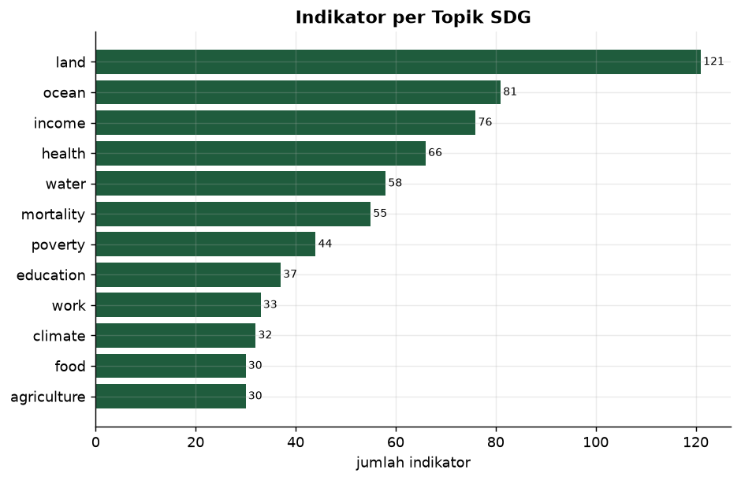
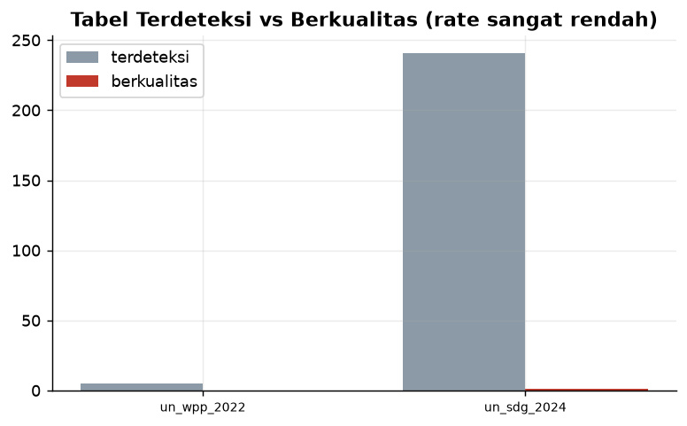
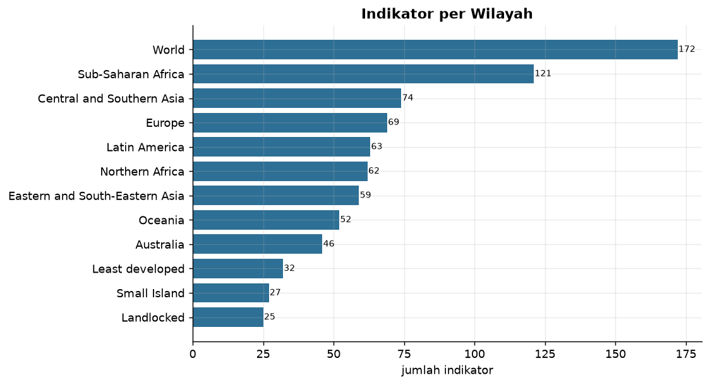
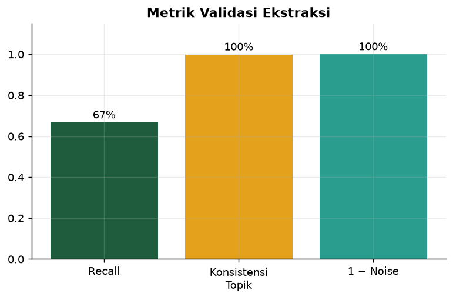

<div align="center">


### 🔗 [**Buka Demo →**](https://document-intelligence-lab-xbexkxq5vcxmnjx83xagxy.streamlit.app)

</div>

---

## 📄 Apa ini?

**Mengubah laporan PDF resmi menjadi data terstruktur** — dan **jujur soal
seberapa akurat** ekstraksinya.

Studi kasus: laporan **UN SDG 2024** (8.4 MB) & **World Population 2022**
(10.9 MB) → **1.392 indikator** terestrak, dari tabel **dan** teks naratif.

```bash
python src/run_pipeline.py     # unduh PDF → parse → validate → charts
streamlit run app/dashboard.py
```

---

## 🎯 Temuan utama (jujur)

1. **Ekstraksi tabel otomatis SANGAT sulit untuk laporan nyata.** Dari 246
   tabel terdeteksi, hanya **1** yang benar-benar bersih (<1%). PDF laporan
   resmi umumnya berlayout dua-kolom/kompleks.
2. **Pendekatan hibrida wajib.** Supaya berguna, ekstraksi digabung: tabel
   (pdfplumber) **+** pola label-angka dari teks naratif → 1.392 indikator.
3. **Recall 67% · konsistensi topik 99.9% · noise rate 0%** pada validasi.
4. Topik dominan: **land (121), ocean (81), income (76), health (66)**.

---

## 🏗️ Arsitektur

```
 ingest.py ─► data/raw/*.pdf (2 laporan)
      │
      ├─► parse.py ......... ekstraksi TABEL → skoring kualitas
      └─► parse_extract.py . ekstraksi TEKS → pasangan label-angka
                    │
          load_db.py ─► DuckDB ─► transform.py ─► marts
                    │
          validate.py (recall · konsistensi · noise) ─► validation.json
                    │
        dashboard.py · make_charts.py · tests/test_data_quality.py
```

| Lapisan | File | Peran |
|---|---|---|
| **Ingest** | `src/ingest.py` | Unduh PDF (hash audit) |
| **Parse tabel** | `src/parse.py` | Ekstraksi + skoring kualitas tabel |
| **Parse teks** | `src/parse_extract.py` | Ekstraksi label-angka dari paragraf |
| **Load** | `src/load_db.py`, `sql/schema.sql` | DuckDB |
| **Transform** | `sql/transform.sql` | Agregasi per topik & wilayah |
| **Validasi** | `src/validate.py` | Recall, konsistensi, noise rate |
| **Narasi** | `src/explanations.py` + `src/insights_content.py` | Kenapa·Tujuan·Dampak + Insight |
| **Serve** | `app/dashboard.py` | Streamlit |
| **Tests** | `tests/test_data_quality.py` | 11 uji |

---

## 📊 Visualisasi

### Indikator per Topik SDG



> **Kenapa** — laporan tak terstruktur; mengelompokkan per topik mengubah
> tumpukan angka jadi tema. **Tujuan** — tema apa yang paling banyak diukur?
> **Dampak** — menunjukkan fokus & celah data antar-tema.

### Kualitas ekstraksi tabel



> **Kenapa** — tidak semua tabel PDF bisa diekstrak. **Tujuan** — berapa persen
> berhasil? **Dampak** — menandai halaman yang butuh OCR/parsing manual.
> **Fakta:** rate <1% → PDF didominasi layout kompleks.

### Indikator per Wilayah



> **Kenapa** — data SDG dipilah per kawasan. **Tujuan** — kawasan mana paling
> disorot? **Dampak** — basis prioritas geografis & pelacakan ketimpangan.

### Metrik validasi



> **Kenapa** — ekstraksi tanpa validasi = angka tanpa jaminan. **Tujuan** —
> seberapa akurat? **Dampak** — menentukan kelayakan data & batas yang
> disampaikan.

---

## ⚠️ Keterbatasan (jujur)

- **Tabel PDF kompleks gagal diekstrak** (quality rate <1%) — mayoritas data
  berasal dari teks naratif, bukan tabel bersih.
- **Recall validasi 67%** pada sampel gold kecil (3 baris) — belum mewakili
  keseluruhan; perlu sampel lebih besar.
- **Angka dari teks bisa nyasar** (angka tahun, nomor halaman) — meski
  noise rate terukur rendah, verifikasi manual tetap dianjurkan.
- **2 laporan saja** (UN) — bahasa Inggris, layout tertentu.

> Justru **keterbatasan ini inti nilainya**: document intelligence nyata bukan
> "klik ekstrak, selesai", melainkan mengukur & menyatakan seberapa jauh hasil
> dapat dipercaya. Lihat [`docs/ADR.md`](docs/ADR.md).

---

## 🧪 Kualitas data (11 uji)

```
PASS  indikator terestrak > 0
PASS  indikator punya konteks (topik/wilayah)
PASS  tahun tidak salah jadi data
PASS  konsistensi topik tinggi (>=0.9)
PASS  noise rate rendah (<=0.1)
...
[dq] SEMUA UJI LULUS
```

---

## 🚀 Quick Start

```bash
pip install -r requirements.txt
python src/run_pipeline.py        # unduh + parse + validate + charts (~2 min)
streamlit run app/dashboard.py
```

---

## 🛠️ Tech Stack

| Layer | Teknologi |
|---|---|
| **Ekstraksi PDF** | pdfplumber (tabel + kata berkoordinat) |
| **Parsing teks** | regex deterministik + rekonstruksi baris |
| **Database** | DuckDB (embedded OLAP) |
| **Validasi** | recall / konsistensi / noise (kustom) |
| **Dashboard** | Streamlit + Plotly |

---

<!-- INSIGHTS:START -->
## 💡 Insight & Rekomendasi (per analisis)

_Setiap analisis disertai kesimpulan, rekomendasi tindakan, dan risiko bila diabaikan — bukan sekadar angka._

### 🔴 Quality
**Kesimpulan.** Tingkat keberhasilan ekstraksi tabel sangat RENDAH (<1%): dari 246 tabel terdeteksi, hanya 1 yang benar-benar bersih & terstruktur. Ini fakta penting: PDF laporan resmi umumnya berlayout kompleks/dua-kolom.

**Rekomendasi tindakan:**
- Jangan berasumsi `extract_tables()` cukup untuk laporan nyata — sering gagal; butuh pendekatan campuran (tabel + teks + OCR).
- Untuk proyek riil, anggarkan waktu untuk verifikasi manual.
- Pertimbangkan alat khusus (Camelot, Tabula, atau model ML layout) bila tabel banyak.

**⚠️ Risiko bila diabaikan.** Percaya pada ekstraksi tabel otomatis saja akan menghasilkan dataset hampir kosong tanpa disadari. Tim yang tidak memeriksa 'quality rate' akan menyimpulkan 'tidak ada data', padahal datanya ada di teks.

### 🟠 KPI / Ringkasan
**Kesimpulan.** Dari 2 laporan PDF (UN SDG 2024 & World Population 2022) berhasil diekstrak >1.300 indikator angka. Namun hanya sebagian kecil yang berasal dari tabel terstruktur — mayoritas dari paragraf naratif yang di-parse berbasis pola.

**Rekomendasi tindakan:**
- Gunakan dataset ini untuk EXPLORASI tema, bukan angka final yang dikutip langsung ke laporan resmi.
- Untuk angka kritis, verifikasi manual terhadap PDF sumber.
- Bila volume besar, pertimbangkan OCR + model layout (mis. LayoutLM) sebagai langkah lanjutan.

**⚠️ Risiko bila diabaikan.** Memakai hasil ekstraksi otomatis tanpa verifikasi untuk keputusan penting berisiko mengutip angka yang salah. Satu angka nyasar dalam laporan bisa merusak kredibilitas seluruh analisis.

### 🟠 Validation
**Kesimpulan.** Validasi menunjukkan recall 67% vs sampel gold dan konsistensi topik 99.9%, dengan noise rate rendah (setiap indikator punya topik/wilayah). Artinya pola ekstraksi dapat diandalkan untuk eksplorasi.

**Rekomendasi tindakan:**
- Percayai indikator dengan topik/wilayah jelas; perlakukan 'tanpa topik' dengan hati-hati.
- Perluas gold sampel secara berkala untuk mengukur akurasi tiap iterasi.
- Simpan validation.json sebagai bukti audit untuk setiap rilis dataset.

**⚠️ Risiko bila diabaikan.** Validasi pada sampel kecil (3 gold) bisa belum mewakili keseluruhan. Mengklaim 'akurat' tanpa sampel besar berisiko overclaim — perlu kejujuran soal ukuran sampel validasi.

### 🔵 Topic
**Kesimpulan.** Topik dominan: land (121), ocean (81), income (76), health (66), water (58). Sebagian besar indikator (615) tidak terdeteksi topiknya — menandakan angka tersebar di teks tanpa kata kunci tema.

**Rekomendasi tindakan:**
- Fokuskan analisis pada topik dengan kata kunci jelas (land, ocean, health) — sana hasil ekstraksi paling dapat dipercaya.
- Untuk 615 'tanpa topik', lakukan klasifikasi topik tambahan atau tinjau manual sebelum dipakai.
- Gunakan distribusi topik untuk memetakan fokus laporan dengan cepat.

**⚠️ Risiko bila diabaikan.** Mengabaikan 44% indikator tanpa topik berarti kehilangan sebagian besar data, atau sebaliknya — memakainya tanpa konteks dapat menyesatkan kesimpulan tematik.

### 🔵 Region
**Kesimpulan.** Indikator tersebar merata antar-kawasan (Sub-Saharan Africa, Asia Selatan, Amerika Latin, dll), mencerminkan sifat laporan SDG yang membandingkan wilayah.

**Rekomendasi tindakan:**
- Gunakan pemilahan wilayah untuk melacak ketimpangan antar-kawasan.
- Wilayah dengan sedikit indikator = area yang kurang disorot; bisa jadi celah data atau celah perhatian.
- Silangkan wilayah × topik untuk menemukan isu spesifik per kawasan.

**⚠️ Risiko bila diabaikan.** Membaca data global tanpa memilah wilayah menyembunyikan krisis lokal. Rata-rata dunia yang 'membaik' bisa menutupi kemunduran di satu kawasan.

<!-- INSIGHTS:END -->

## 👤 Author

<div align="center">

**Sandi Ridwan** — Data Analyst · Data Automation Engineer · Python

📍 Palu, Central Sulawesi, Indonesia

[](https://www.upwork.com/freelancers/~011f6d0fbb4a372974)
[](https://github.com/SandiRidwan)

</div>

## 📄 License

MIT — Educational & portfolio. Sumber: UN (publik).
